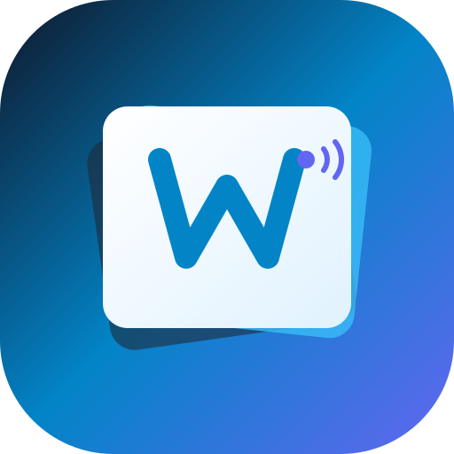

# WordPlay — Vocab Swipe 🎴✨

<p align="center">
  
</p>

<p align="center">
  <strong>A modern, frictionless vocabulary building app inspired by gesture swiping, native speech, and bilingual Hindi-English contextual learning.</strong>
</p>

<p align="center">
  <a href="https://kundan789.github.io/wordplay/"></a>
  <a href="https://github.com/Kundan789/wordplay/actions/workflows/deploy.yml"></a>
  
  
  
  
</p>

---

## 🌐 Live Web App

The application is deployed 24/7 on GitHub Pages. Anyone can access and install it directly from any mobile or desktop browser without an app store:

👉 **[https://kundan789.github.io/wordplay/](https://kundan789.github.io/wordplay/)**

---

## 📖 About WordPlay

Traditional vocabulary building apps suffer from two major flaws:
1. **High Cognitive Friction**: Complex UIs, endless drills, and dry flashcard lists make daily practice feel like a chore.
2. **The Bilingual Disconnect**: Learners in bilingual regions (e.g., India) often know the rough concept of a word in their native language (Hindi) but struggle to connect it with English usage and exact pronunciation.

**WordPlay** re-imagines vocabulary acquisition through **playful micro-learning**:
- Combines the addictive, physical tactile feel of **Tinder-style card swiping** with spaced repetition.
- Features **clean, back-of-card Hindi meanings** that ground complex words in native context without giving away the answer on the front.
- Built-in **native speech synthesis** ensures learners pronounce sophisticated words with confidence.
- Requires **zero login**, **zero subscription**, and works **100% offline** as an installable Progressive Web App (PWA).

---

## ✨ Key Features

### 🎴 1. Tinder-Style Card Swiping
- **Swipe Right** (`👉`): Save to your personal *Remember Library*.
- **Swipe Left** (`👈`): Pass and move to the next word.
- **Tap Card** (`🔄`): Flips between the Front (Pronunciation & part-of-speech) and Back (Definition, Hindi translation & real-world examples).
- Smooth 60 FPS spring physics powered by **Framer Motion**.

### 🇮🇳 2. Bilingual Hindi Translation
- Each card features an accurate, carefully curated Hindi definition on the back of the card.
- Clean typography without distracting highlights ensures focus remains on natural comprehension.

### 🔊 3. High-Fidelity Audio Pronunciation
- Zero-latency voice synthesis via the **Web Speech API**.
- Includes a **Speed Toggle (1.0x Normal / 0.7x Slow)** so learners can dissect fast, complex syllables.

### 📚 4. Remember Library
- Dedicated bookmark vault storing all words you have chosen to remember.
- Filter by category, review definitions, search saved cards, or delete mastered words.
- Stored permanently in local storage—safe, private, and offline.

### 🧠 5. Dual-Mode Memory Quiz
- **4-Choice MCQ Mode**: Test yourself with 4 rapid options, live score tracking, and instant sound effects.
- **Flashcard Mode**: Self-paced active recall to reinforce retention.
- Includes starter decks so quizzes are immediately playable even before saving cards!

### 📲 6. Installable Progressive Web App (PWA)
- Can be added directly to the Android / iOS home screen as a standalone application.
- Works without an internet connection using local cache and service workers.

---

## 🚀 How to Access & Install

### On Mobile (Android / Chrome)
1. Open [https://kundan789.github.io/wordplay/](https://kundan789.github.io/wordplay/) in Chrome.
2. Tap the bottom banner **"Get App"** or tap the browser menu (`⋮`) and select **"Add to Home screen"**.
3. WordPlay will install as an app with its own icon and full-screen experience!

### On iPhone (iOS / Safari)
1. Open the link in **Safari**.
2. Tap the **Share** button (`⬆`).
3. Scroll down and tap **"Add to Home Screen"**.

---

## 🛠️ Tech Stack & Architecture

| Layer | Technologies |
|---|---|
| **Framework** | [React 18](https://react.dev/) + [TypeScript](https://www.typescriptlang.org/) |
| **Build Tool** | [Vite 8](https://vitejs.dev/) |
| **Styling** | [Tailwind CSS 3](https://tailwindcss.com/) with Custom Slate/Ambient Mesh Theme |
| **Animations** | [Framer Motion](https://www.framer.com/motion/) (gestures, flip transforms, springs) |
| **Icons** | [Lucide React](https://lucide.dev/) |
| **Audio Engine** | Web Speech API (`SpeechSynthesis`) + HTML5 Audio SFX |
| **Offline / PWA** | Service Worker (`sw.js`) + Web App Manifest |
| **Hosting & CI/CD** | GitHub Pages + GitHub Actions Workflow |

---

## 💻 Local Development Setup

To run WordPlay locally on your machine:

```bash
# 1. Clone the repository
git clone https://github.com/Kundan789/wordplay.git

# 2. Enter the project directory
cd wordplay

# 3. Install dependencies
npm install

# 4. Start the development server (accessible on PC and local network)
npm run dev
```

Visit `http://localhost:5173/` in your browser.

### Building for Production

```bash
npm run build
```
Generates optimized, bundled static assets inside the `/dist` directory.

---

## 📄 Project Report

For a complete breakdown of the pedagogical methodology, system design decisions, and social impact of WordPlay, view the project report:
- 📄 [WordPlay_Comprehensive_Project_Report.docx](https://github.com/Kundan789/wordplay/blob/main/WordPlay_Comprehensive_Project_Report.docx)

---

## 👤 Author & Credits

- **Developer**: [Kundan789](https://github.com/Kundan789)
- **Repository**: [https://github.com/Kundan789/wordplay](https://github.com/Kundan789/wordplay)
- **Live Deployment**: [https://kundan789.github.io/wordplay/](https://kundan789.github.io/wordplay/)

---

<p align="center">
  Made with ❤️ for students, GRE/IELTS test-takers, and lifelong learners.
</p>
